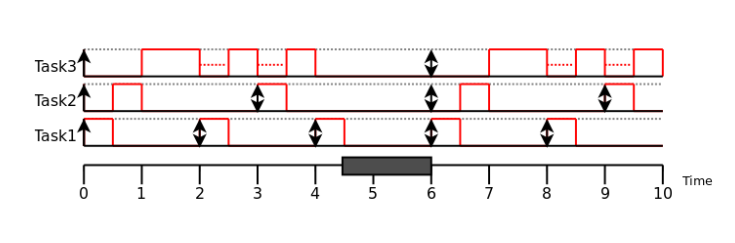
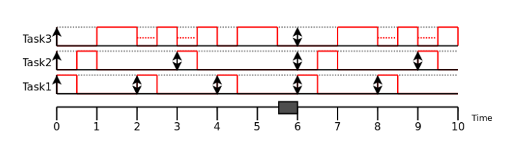
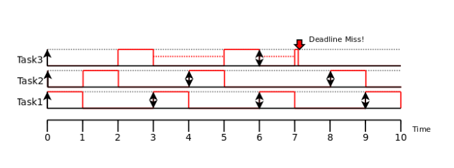
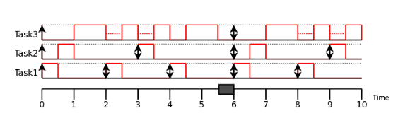

# Example 1

### Task properties

| Task  | Execution time (Ci) | Period (Ti) |
|---:|---:|---:|
| 1 | 0.5 | 2 |
| 2 | 0.5 | 3 |
| 3 | 2 | 6 |

The total utilization is:

$$
U = \sum_i \frac{C_i}{T_i}
  = \frac{0.5}{2} + \frac{0.5}{3} + \frac{2}{6}
  = 0.75 = 75\%.
$$

In other words, the CPU is busy 75% of the time.

For n = 3, the Liu–Layland utilization bound is:

$$
U_{lub}(3) = 3\left(2^{1/3} - 1\right)
           \approx 0.78 = 78\%.
$$

Since the utilization (0.75) is below the bound (0.78), one execution per period is guaranteed.

# Example 2

### Task properties

| Task  | Execution time (Ci) | Period (Ti) |
|---:|---:|---:|
| 1 | 0.5 | 2 |
| 2 | 0.5 | 3 |
| 3 | 3 | 6 |

The total utilization is:

$$
U = \sum_i \frac{C_i}{T_i}
  = \frac{0.5}{2} + \frac{0.5}{3} + \frac{3}{6}
  \approx 0.92 = 92\%.
$$

For three tasks, the U_lub bound is approximately 0.78 (78%), as above.

Since the utilization (0.92) is above the bound (0.78), the utilization-bound test cannot guarantee schedulability. However, the task set is schedulable.

# Example 3

### Task properties

| Task  | Execution time (Ci) | Period (Ti) |
|---:|---:|---:|
| 1 | 1 | 3 |
| 2 | 1 | 4 |
| 3 | 2.1 | 6 |

The total utilization is:

$$
U = \sum_i \frac{C_i}{T_i}
  = \frac{1}{3} + \frac{1}{4} + \frac{2.1}{6}
  \approx 0.93 = 93\%.
$$

For three tasks, the U_lub bound is approximately 0.78 (78%), as above.

Since the utilization (0.93) is above the bound (0.78), the utilization-bound test cannot guarantee schedulability, and this task set is not schedulable.

# Harmonic Periods

No caso de um conjunto de tarefas com períodos harmônicos, isto é, quando os períodos maiores são múltiplos inteiros dos peíodos menores, desde que a soma das utilizações seja menor ou igual a 1, o conjunto de tarefas é garantidamente escalonável. 

# Response-time analysis

The response-time analysis allows computing the exact completion time of each task, instead of relying only on a sufficient utilization test.

For a task $i$, the recurrence is:

$$
R_i^{(0)} = C_i
$$

$$
R_i^{(n+1)} = C_i + \sum_{k \in hp(i)} \left\lceil \frac{R_i^{(n)}}{T_k} \right\rceil C_k
$$

where:
- $C_i$ is the execution time of task $i$;
- $T_k$ is the period of task $k$;
- $hp(i)$ is the set of tasks with higher priority than $i$.

The iteration converges when $R_i^{(n+1)} = R_i^{(n)}$.

# Example

### Task properties

| Task | $C_i$ | $T_i$ |
|---:|---:|---:|
| 1 | 0.5 | 2 |
| 2 | 0.5 | 3 |
| 3 | 3 | 6 |

Assume implicit deadlines, i.e. $D_i = T_i$.

## Task 1

$$
R_1^{(0)} = C_1 = 0.5
$$

Since there are no higher-priority tasks, the response is immediate:

$$
R_1 = 0.5
$$

## Task 2

Task 2 has only task 1 as a higher-priority task.

$$
R_2^{(0)} = C_1 + C_2 = 0.5 + 0.5 = 1
$$

$$
R_2^{(1)} = C_2 + \left\lceil \frac{R_2^{(0)}}{T_1} \right\rceil C_1
= 0.5 + \left\lceil \frac{1}{2} \right\rceil 0.5
= 0.5 + 1 \cdot 0.5 = 1
$$

The value converged, thus:

$$
R_2 = 1
$$

## Task 3

Task 3 has tasks 1 and 2 as higher-priority tasks.

$$
R_3^{(0)} = C_1 + C_2 + C_3 = 0.5 + 0.5 + 3 = 4
$$

$$
R_3^{(1)} = C_3 + \left\lceil \frac{4}{2} \right\rceil 0.5 + \left\lceil \frac{4}{3} \right\rceil 0.5
= 3 + 2\cdot 0.5 + 2\cdot 0.5 = 5
$$

$$
R_3^{(2)} = C_3 + \left\lceil \frac{5}{2} \right\rceil 0.5 + \left\lceil \frac{5}{3} \right\rceil 0.5
= 3 + 3\cdot 0.5 + 2\cdot 0.5 = 5.5
$$

$$
R_3^{(3)} = C_3 + \left\lceil \frac{5.5}{2} \right\rceil 0.5 + \left\lceil \frac{5.5}{3} \right\rceil 0.5
= 3 + 3\cdot 0.5 + 2\cdot 0.5 = 5.5
$$

A iteração convergiu, logo:

$$
R_3 = 5.5
$$

## Verificação da escalonabilidade

Comparing each response time with its corresponding deadline:

$$
R_1 = 0.5 \leq 2, \quad
R_2 = 1 \leq 3, \quad
R_3 = 5.5 \leq 6
$$

Como todas as tarefas cumprem os seus deadlines, o conjunto é escalonável.

Em resumo, o response-time analysis confirma que, para este conjunto, todas as tarefas têm resposta temporal aceitável.